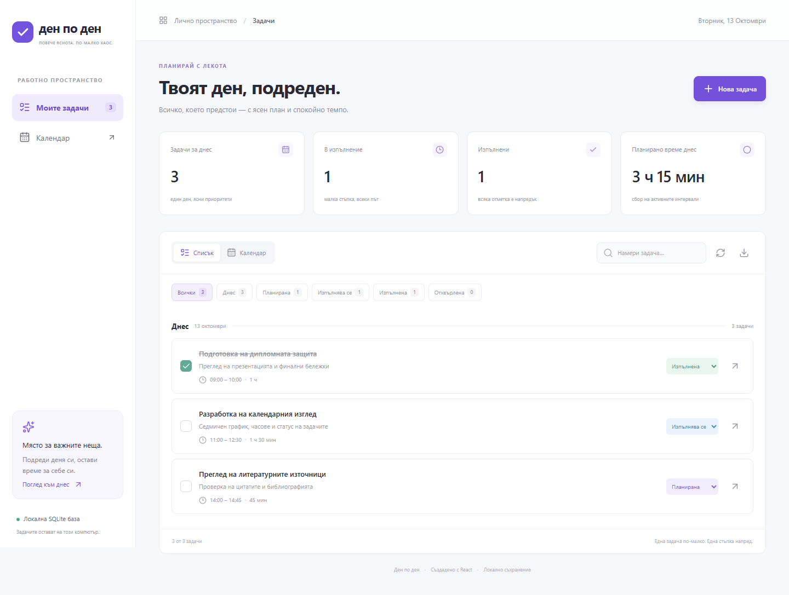

# Ден по ден — todo-react

Локално приложение за управление на задачи на български език. Създадено като практическа част на дипломна работа „Създаване на приложение за управление на задачи чрез React“.



## Възможности

Задачата съдържа заглавие, описание, дата, начален час и продължителност. Статусът се избира между „Планирана“, „Изпълнява се“, „Отхвърлена“ и „Изпълнена“. Списъкът позволява редактиране, изтриване с потвърждение, бързо завършване, търсене на български и филтриране. Календарът има месечен, седмичен и дневен преглед; изборът на ден отваря форма за нова задача, а изборът на събитие отваря редакцията му.

Продължителността е от 5 до 1440 минути. Задачите могат да преминават след полунощ. Формулярът предупреждава при застъпване, но допуска запис. Данните се съхраняват във файл SQLite на текущия компютър. Експортът изтегля JSON с всички задачи; автоматичен импорт на този файл не е реализиран.

## Инсталация на Windows

Необходими са **Node.js 24 или по-нова версия**, npm и Git. Изпълнената проверка използва Node.js 24.0.2. В тази версия `node:sqlite` показва предупреждение за експериментален модул; проектът фиксира зависимостите чрез `package-lock.json`.

При използваната Windows среда npm изисква доверените системни сертификати. Ако инсталацията съобщи `UNABLE_TO_VERIFY_LEAF_SIGNATURE`, преди `npm ci` се изпълнява следната настройка за текущия прозорец. Проверката на TLS сертификатите остава включена.

```powershell
# Използва доверените сертификати от Windows за текущия процес на Node.js.
$env:NODE_OPTIONS = "--use-system-ca"
```

```powershell
# Изтегляне на проекта и възстановяване на точните зависимости.
git clone https://github.com/yanislavtankov/todo-react.git C:\Projects\todo-react
cd C:\Projects\todo-react
npm ci

# Едновременно стартиране на интерфейса и локалния API.
npm run dev
```

Отваря се **http://127.0.0.1:5173**. Vite обслужва интерфейса, а Express API работи на порт 4317. Портовете трябва да са свободни. Затварянето с `Ctrl+C` спира двата процеса. SQLite се създава автоматично при първото стартиране в `data/tasks.sqlite`. Папката `data` е изключена от Git.

## Стартиране на готовата версия

```powershell
# Компилиране и обслужване на интерфейса от един локален процес.
npm run build
npm start
```

Адресът на готовото приложение е **http://127.0.0.1:4317**. Данните остават същите при преминаване между режимите. Приложението обслужва само локалния адрес; то е предназначено за един потребител и няма регистрация, потребителски роли или облачна синхронизация.

## Проверки

```powershell
# Петнадесет проверки на домейн логиката, API и устойчивото съхранение.
npm test

# Шест браузърни сценария. Необходим е инсталиран Google Chrome.
npm run test:e2e

# Всички проверки и компилацията в обща последователност.
npm run check
```

Браузърните тестове създават отделна база `data/e2e.sqlite` и използват портове 3002 и 5180. Работната база не се почиства. Резултатите се записват в `test-results/results.json`. Екранните снимки в `docs/images` съдържат само демонстрационни данни. Проверените изгледи са 1440 × 1000 и 390 × 844 пиксела. Календарните тестове използват текущата локална дата, за да останат приложими и през друг месец.

